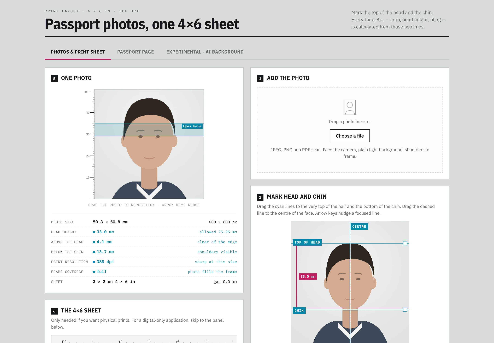
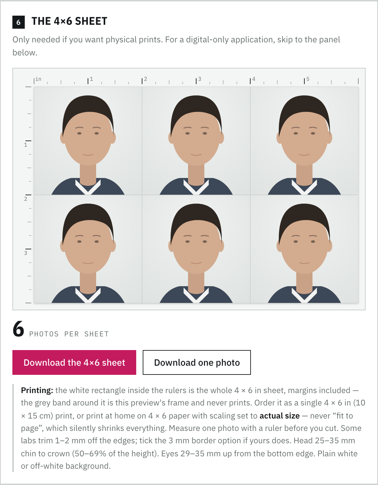
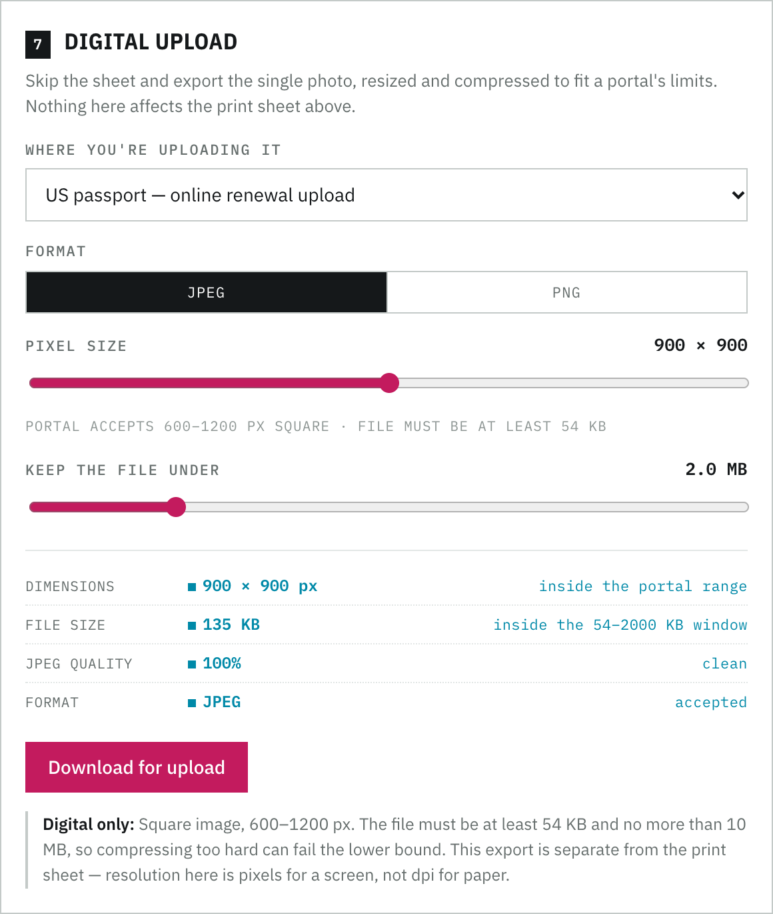
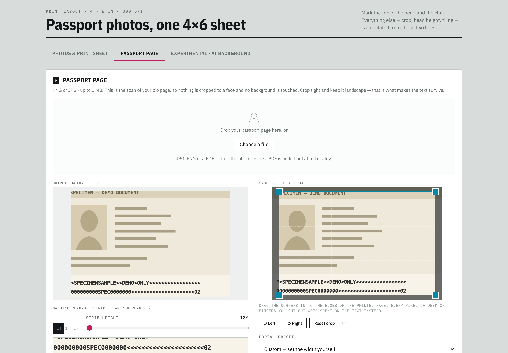
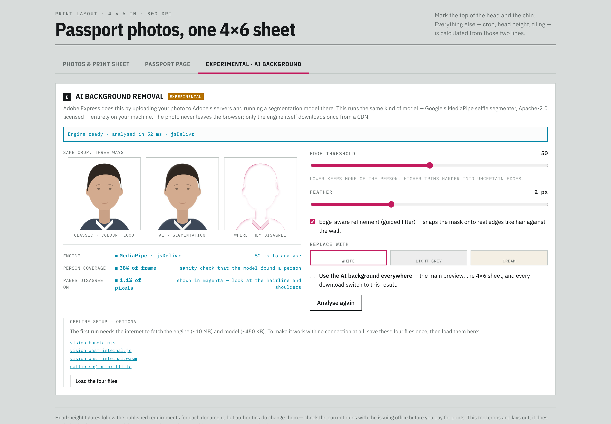

# Passport Photo Tool

Passport and visa photos, print sheets, and document scans — prepared entirely
in your browser, in **one self-contained HTML file**. No install, no build, no
server, no account.

Your photo and your passport scan are biometric documents. This tool never
uploads them anywhere: every crop, resize, compression pass, and background
removal runs on your own machine. Open the file, do the job, close the tab.

**▶ Use it now: [drpoutine.github.io/passport-photo-tool](https://drpoutine.github.io/passport-photo-tool/)** —
the same file served as-is by GitHub Pages. Your images still never leave your
machine; downloading the file and double-clicking it works identically.

## What it does

### 📐 Photos & print sheet

Drag two lines — top of the head, bottom of the chin — and everything else is
calculated: the crop, the head-height compliance, the tiling on a 4×6 print
sheet at 300 dpi.

- Built-in standards, verified against official sources: **Brazil** (5×7 cm),
  **Canada** (50×70 mm), **China** (33×48 mm), **India** (2×2 in),
  **Ireland / EU / Schengen** (35×45 mm), **Saudi eVisa**, **UK** (35×45 mm),
  **US** (2×2 in), plus a fully custom size.
- Live readouts with pass/warn dots: head height against the allowed range,
  margins above the head and below the chin, effective print resolution, eye
  zone where the standard defines one.
- A 4×6 in sheet tiler that fits as many photos as the format allows
  (6 for a US 2×2, 8 for 35×45, 9 for China's 33×48) with cut guides on every
  sheet and inch rulers around the preview so you can see exactly what prints.
- Downloads are DPI-stamped JPEGs — labs print them at actual size.

### 📤 Digital upload

Government portals have hard limits — exact pixel sizes, file-size ceilings,
and sometimes file-size *floors*. The exporter binary-searches JPEG quality to
land just under the cap, climbs back up if a portal has a minimum, and shrinks
pixels only as a last resort. Presets for:

- **Ireland** Passport Online (≥715×951 px, <9 MB — height checked, not just width)
- **Nusuk** Hajj personal photo (exactly 480×640 px, ≤1 MB — centre-cut from your crop, never stretched)
- **Saudi eVisa** (exactly 200×200 px, 5–100 KB — the 5 KB floor is enforced too)
- **US passport** online renewal (600–1200 px, 54 KB–10 MB)
- **US visa DS-160 / CEAC** (600–1200 px square JPEG, <240 KB)
- anything else, with the limits set by hand

Square portals centre-crop non-square photo formats instead of stretching
them, and the readout tells you when that happens.

### 🛂 Passport page (bio-page scan)

For portals that want a scan of the passport itself. Crop and rotate at full
resolution, size the output by **pixels per MRZ character** (the two lines of
`<<<` text are 44 characters wide — width buys legibility directly), clean up
paper noise, and inspect the machine-readable strip at 1:1 pixels before you
upload. A **Nusuk preset** (the default) keeps the page inside Nusuk's enforced
400–1200 px wide × 400–2000 px tall box at the full 1200 px width. Encodes PNG-8 (in-file quantizer), PNG-24, and JPEG on every pass and
shows the size of each, so the format choice is informed, not guessed.

### 📄 PDF input

Both uploaders accept PDFs. Scanner apps wrap your scan in a PDF around an
embedded JPEG — the tool pulls that JPEG out **at original quality, fully
offline**, by walking the raw bytes. Only a PDF with no usable embedded image
(vector pages, exotic encodings) falls back to rendering page 1 with
[pdf.js](https://mozilla.github.io/pdf.js/) from a CDN. A "Source" readout
always says which path was used.

### 🧪 AI background removal (experimental)

The same job cloud tools do server-side, running on your machine instead:
Google's MediaPipe selfie segmenter (Apache-2.0, 454 KB model) with an
edge-aware guided filter, compared side-by-side against the built-in classic
colour-flood remover, with a disagreement map so you can judge the edges
yourself before trusting either.

## Getting started

**Online:** open [drpoutine.github.io/passport-photo-tool](https://drpoutine.github.io/passport-photo-tool/).

**Offline / local:**

1. Download [`passport-photo-4x6-sheet.html`](passport-photo-4x6-sheet.html)
   (one file, ~130 KB).
2. Double-click it. It opens and works from `file://` — no server needed.
3. Drop in a photo.

Either way, processing happens in your browser — the hosted copy is byte-identical
to the file in this repo.

## What needs the internet

| Feature | Network use |
|---|---|
| Photos, print sheet, digital upload | **None** |
| Passport page scan + PDF with embedded scan | **None** |
| PDF with no embedded image | pdf.js from CDN, on first use |
| AI background removal | engine (~10 MB) + model (454 KB) from CDN on first use — or load four files once for fully offline use (instructions in the tab) |
| Fonts | Google Fonts, with system-font fallback |

## Under the hood

- One classic script, zero dependencies, no build step.
- Every export path resamples with a hand-written **Lanczos-3** filter
  (alias-safe 2:1 halvings, then one windowed-sinc pass) — measured ~40×
  better aliasing suppression than the browser's built-in scaler.
- File-size targeting is a **binary search over JPEG quality**, not a fixed
  quality guess.
- The PNG-8 encoder (median-cut quantizer + deflate via `CompressionStream`)
  lives in the file — document scans typically come out ~⅔ smaller than
  PNG-24 with every letterform intact.
- The PDF extractor walks JPEG marker structure over the raw PDF bytes, so it
  survives EXIF thumbnails, progressive scans, and restart markers, and never
  re-encodes your scan.

## Honest limitations

- MediaPipe segments at 256×256 internally — hair edges are coarser than
  server-side tools. The compare view exists so you can check before using it.
- Multi-page PDFs: the largest embedded image (or page 1) is used — no page
  picker yet.
- Portals change their validation rules without notice. Specs here were
  verified against official pages, but re-check on any rejection.
- The layout is desktop-first; small screens work but aren't polished yet.

## Disclaimer

This tool crops, sizes, and compresses. It does not judge lighting,
expression, glasses, or background colour — the things that cause most
rejections. Check the issuing authority's current requirements before you
submit or pay for prints. The demo images in this README are synthetic
specimens, not real people or documents.
